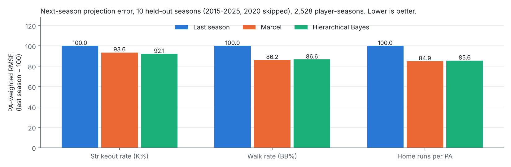
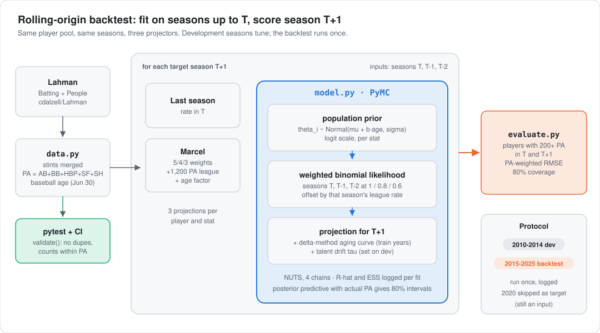
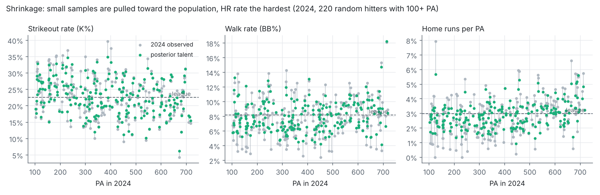
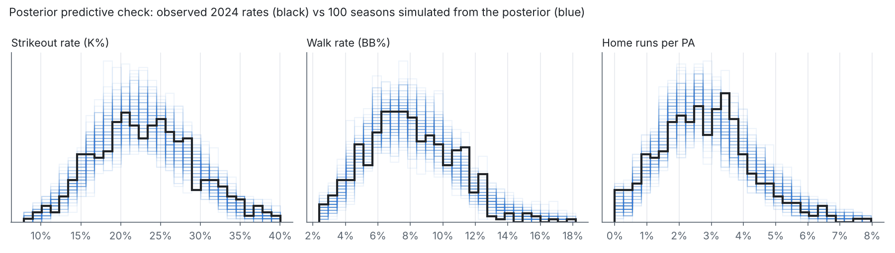
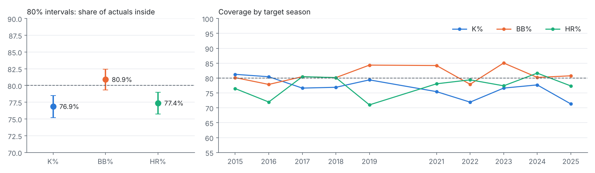

<div align="center">

# MLB Bayesian True-Talent Projections

**How much of a hitter's strikeout, walk and home-run rate is skill, and how much is noise?**
<br>A hierarchical Bayesian model in PyMC, backtested over 10 held-out seasons against last-season rates and Marcel, the standard public projection baseline.

[](https://github.com/Jitesh-Mishra/mlb-bayesian-true-talent-projections/actions/workflows/ci.yml)


| **8 to 14%** | **within 1.3%** | **77 to 81%** | **51 / 119 / 164 PA** |
|:---:|:---:|:---:|:---:|
| lower PA-weighted RMSE than last-season rates (K%, BB%, HR%) | of Marcel on every stat: a tie, not a win | of actual next-season rates land inside the 80% intervals | stabilization points the model learns for K%, BB%, HR% |

</div>

<picture>
  <source media="(prefers-color-scheme: dark)" srcset="reports/figures/results-dark.png">
  
</picture>

> **The honest summary.** The model beats naive last-season rates clearly, and ties Marcel. On the one stat where it did better on the development seasons (K%, 4.3% better than Marcel), the edge shrank to 1.3% on the backtest, and the 95% interval includes zero. What the model adds over Marcel is not accuracy. It's calibrated uncertainty (an 80% interval per player) and parameters with a meaning (how much each stat varies across hitters, so how fast it stabilizes).

## Why
Small samples lie. A hitter with a 30% strikeout rate in 150 PA might be a 30% hitter, or a 24% hitter who had a bad month. Front offices regress small samples toward the league, and Marcel does it with a fixed rule (1,200 PA of league average for every stat). A hierarchical model learns the amount from the data, separately for each stat, and gives an interval as well as a point.

## How it works

<picture>
  <source media="(prefers-color-scheme: dark)" srcset="docs/img/architecture-dark.svg">
  
</picture>

- **Data** (`mlbproj/data.py`): Lahman `Batting` and `People`, one row per player-season with stints on different teams merged, PA = AB + BB + HBP + SF + SH, and baseball age (age on June 30). `validate()` checks for duplicate player-seasons, counts above PA, HR above H, and missing or implausible ages; pytest runs it on the real tables in CI.
- **Baselines** (`mlbproj/baselines.py`):
  - **Last season:** the rate in season T.
  - **Marcel:** seasons T, T-1, T-2 weighted 5/4/3, plus 1,200 PA at the player's own mix of league rates, times Marcel's age factor (+0.6% a year under 29, −0.3% a year over; inverted for K%).
- **Model** (`mlbproj/model.py`), one fit per stat and origin season, on the logit scale:
  - **Population prior:** each hitter's talent relative to the league is `theta_i ~ Normal(mu + b_age·age, sigma)`. `sigma` is learned, and it decides how hard small samples shrink.
  - **Likelihood:** binomial counts from seasons T, T-1 and T-2, each offset by that season's league rate, with log-likelihood weights 1 / 0.8 / 0.6 (Marcel's 5/4/3), because older seasons say less about current talent.
  - **Aging:** a delta-method curve (average change between consecutive seasons by age), fitted only on season pairs that end by T.
  - **Projection:** talent plus aging plus a year-to-year drift term, then binomial noise at the hitter's actual PA, which gives the 80% interval.
  - **Sampling:** NUTS, 4 chains × 1,000 draws. Across all 30 backtest fits: max R-hat 1.010, min bulk ESS 2,104, 0 divergences.
- **Backtest** (`mlbproj/evaluate.py`): rolling origin. For each target season, everything is fit on seasons before it. Scored on hitters with 200+ PA in both seasons, weighted by next-season PA.
  - Target seasons 2010-2014 were for development; the drift term was set there.
  - 2015-2025 is the backtest, run once (`reports/final_test_runs.json`). 2020, the 60-game season, is skipped as a target but used as an input.

## Results

### Accuracy: 10 held-out seasons, 2,528 player-seasons per stat

| Stat | Last season | Marcel | Hierarchical Bayes | vs last season | vs Marcel (95% CI) |
|---|---:|---:|---:|---:|---:|
| K% | 0.0343 | 0.0321 | **0.0316** | **−7.8%** | −1.3% (−2.8% to +0.1%) |
| BB% | 0.0232 | **0.0200** | 0.0201 | **−13.4%** | +0.3% (−0.6% to +1.2%) |
| HR per PA | 0.0139 | **0.0118** | 0.0119 | **−14.2%** | +0.9% (−0.1% to +1.8%) |

<sub>PA-weighted RMSE of the projected rate vs the actual next-season rate. Negative = lower error. CIs come from a bootstrap that resamples players with all their seasons together. `reports/results_eval.csv`, per season in `reports/per_season_eval.csv`.</sub>

- Shrinkage helps most where a season is the noisiest measure of skill: HR rate (−14%) and BB% (−13%), against −8% for K%.
- Against Marcel it's a tie on all three stats. Season by season, the model's HR-rate error ranges from 9% better than Marcel to 7% worse. The big swings come in seasons when the league home-run rate moved sharply (2015 +17%, 2018 −9%, 2019 +20%, 2022 −12%), which neither method can anticipate. The two methods react differently to those shifts.
- On BB%, the model's three worst seasons against Marcel are 2021, 2022 and 2024, with 4% to 6% more error. 2021 was projected from the 60-game 2020 season.

### Shrinkage, and what it implies

<picture>
  <source media="(prefers-color-scheme: dark)" srcset="reports/figures/shrinkage-dark.png">
  
</picture>

The learned spread of talent (`sigma`) sets the stabilization point: the PA at which a hitter's own rate gets half the weight.

| Stat | Talent spread (logit sd) | Stabilization point |
|---|---:|---:|
| K% | 0.337 | 51 PA |
| BB% | 0.332 | 119 PA |
| HR per PA | 0.453 | 164 PA |

<sub>`reports/stabilization.csv`. The fit population is hitters with 100+ PA, so this is the reliability within that group.</sub>

These numbers are close to the commonly cited stabilization points from public research (roughly 60, 120 and 170 PA). Strikeouts reveal skill fastest, and home runs need about three times the sample.

### Is the model plausible? Posterior predictive check

<picture>
  <source media="(prefers-color-scheme: dark)" srcset="reports/figures/ppc-dark.png">
  
</picture>

Seasons simulated from the posterior reproduce the shape of the observed 2024 rates, including the skew in HR rate. K% is slightly flatter than the simulations. That is the visible cost of assuming one fixed talent across three seasons: real talent drifts within the window.

### Calibration: are the 80% intervals honest?

<picture>
  <source media="(prefers-color-scheme: dark)" srcset="reports/figures/calibration-dark.png">
  
</picture>

| | K% | BB% | HR per PA |
|---|---:|---:|---:|
| Dev seasons, no drift term | 68.8% | 71.5% | 79.0% |
| Drift chosen on dev (logit sd) | 0.10 | 0.15 | 0.10 |
| **Backtest coverage** | **76.9%** | **80.9%** | **77.4%** |

Without a drift term the intervals were too narrow (69% on K%), because the posterior describes talent as of last season, and talent moves. The drift term was chosen on 2010-2014 only (`reports/drift_calibration_dev.csv`) and then frozen. On the backtest, BB% is calibrated and K% and HR rate run about 3 points light.

## Run it

```bash
pip install -r requirements.txt
pytest -q                               # data validation on the real Lahman tables, baselines, simulated model recovery
python -m mlbproj.evaluate dev          # target seasons 2010-2014, plus the drift grid (about 4 min on 2 CPUs)
python -m mlbproj.evaluate eval         # the backtest, 2015-2025 (about 8 min); appends to reports/final_test_runs.json
python scripts/stabilization.py
python scripts/make_figures.py          # refits the 2024 origin for the shrinkage and PPC figures
```

The Lahman tables are downloaded from [cdalzell/Lahman](https://github.com/cdalzell/Lahman) on first use and cached in `data/` (not committed).

## Limitations
- **Outcomes only.** There are no Statcast inputs (exit velocity, chase rate). Those stabilize faster than outcomes and are where real projection gains come from.
- **No park or league adjustment.** A hitter who moves to Coors Field is projected as if he hadn't.
- **The future league rate is assumed equal to last season's**, the same as Marcel. League-wide shifts (ball changes) dominate the season-to-season error on HR rate.
- **Survivor bias.** The aging curve uses the delta method, and the scored population is hitters who kept their jobs (200+ PA in both seasons).
- **Coverage is 77% on K% and HR rate, not 80%.** The drift term is one number per stat. A per-age or per-player drift would be the next step.

## Next
- Statcast-based priors: exit velocity and barrel rate for HR, whiff and chase rate for K% and BB%.
- A random-walk talent process in place of fixed Marcel-style weights.
- Model the league environment as a latent season effect.
- Port to R with brms/Stan for a cross-check.
- Pitcher K%.

---
<sub>**Stack:** Python, PyMC, ArviZ, pandas, NumPy, SciPy, Matplotlib, pytest, GitHub Actions. **Data:** [Lahman Baseball Database](https://sabr.org/lahman-database/) via [cdalzell/Lahman](https://github.com/cdalzell/Lahman) (CC BY-SA 3.0). **Decisions:** [`docs/decisions.md`](docs/decisions.md).</sub>
